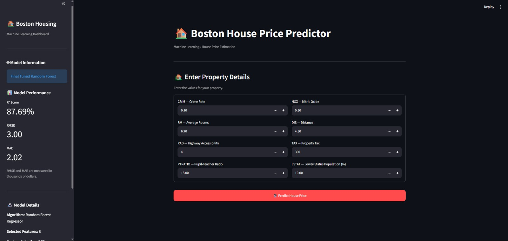
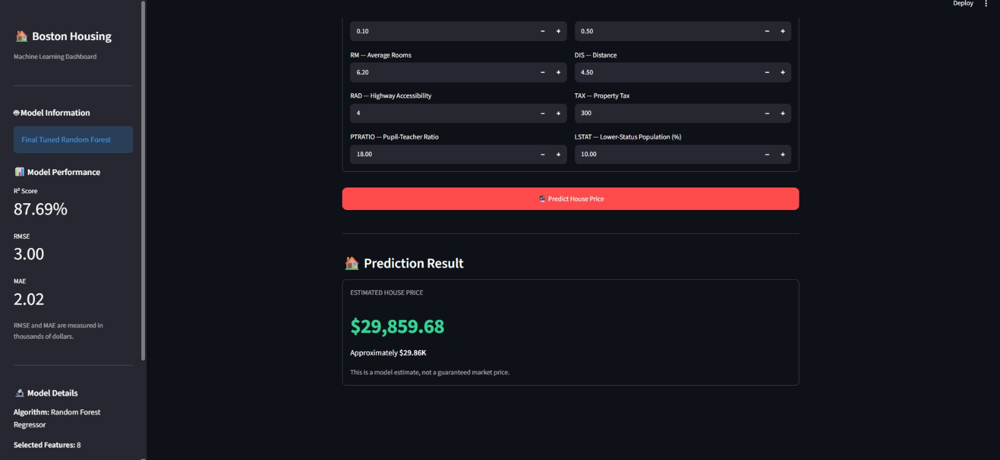

# 🏠 Boston House Price Prediction | Machine Learning & Streamlit

A machine learning project that predicts estimated Boston housing prices using regression algorithms, exploratory data analysis (EDA), feature selection, and a Streamlit web application.

The project covers the complete machine learning workflow, from raw data exploration to model training, evaluation, saving, and interactive prediction.

## 📌 Project Overview

The objective of this project is to build a regression model that estimates housing values based on selected housing, environmental, and socioeconomic features.

The project includes:
- Exploratory Data Analysis (EDA)
- Data quality checks and cleaning
- Univariate, bivariate, and multivariate analysis
- Outlier detection and treatment
- Train-test splitting and feature scaling
- Recursive Feature Elimination (RFE)
- Regression model comparison
- Random Forest hyperparameter tuning
- Model persistence using Joblib
- Interactive Streamlit dashboard

## 🎯 Objectives

- Understand the relationships between housing features and property values.
- Identify patterns, distributions, correlations, and potential outliers.
- Compare multiple regression algorithms.
- Select and tune a final machine learning model.
- Build an interactive interface for making predictions on new inputs.

## 🛠️ Technologies Used

| Technology | Purpose |
|---|---|
| Python | Programming language |
| Pandas | Data manipulation |
| NumPy | Numerical computing |
| Matplotlib | Data visualization |
| Seaborn | Statistical visualization |
| Scikit-learn | Preprocessing, feature selection, model training and evaluation |
| Joblib | Saving and loading trained models |
| Streamlit | Interactive web application |
| Jupyter Notebook | Data analysis and model development |

## 📂 Project Structure

```text
Boston-House-Price-Prediction/
│
├── app.py
├── Boston_House_Price_Prediction.ipynb
├── boston_house_price_model_final.joblib
├── requirements.txt
├── README.md
│
└── screenshots/
    ├── dashboard.png
    └── prediction_result.png
```

*The screenshot files are recommended additions. Create the `screenshots/` folder and add your actual screenshots before using the image links below.*

## 📊 Dataset Description

This project uses the classic Boston Housing dataset, which contains 506 observations and 14 columns, including 13 input features and the target variable `MEDV`.

### Selected Features

| Feature | Description |
|---|---|
| `CRIM` | Per-capita crime rate by town |
| `NOX` | Nitric oxide concentration |
| `RM` | Average number of rooms per dwelling |
| `DIS` | Weighted distance to employment centres |
| `RAD` | Accessibility to radial highways |
| `TAX` | Property-tax rate per $10,000 |
| `PTRATIO` | Pupil-teacher ratio by town |
| `LSTAT` | Percentage of lower-status population |

**Target variable:** `MEDV` — median value of owner-occupied homes, measured in thousands of dollars in the original dataset.

The eight input features above were selected using Recursive Feature Elimination (RFE) in the project's model-development workflow.

**Dataset note:** The classic Boston Housing dataset is historical and has known ethical limitations, including the use of sensitive socioeconomic variables. It should be treated as an educational dataset, not as a suitable basis for real-world property valuation or housing decisions.

## 🔎 Exploratory Data Analysis (EDA)

The notebook explores the dataset through the following stages:

1. Data loading and initial inspection
2. Dataset dimensions, data types, and descriptive statistics
3. Missing-value and duplicate checks
4. Univariate analysis using histograms and count plots
5. Bivariate analysis using scatter plots and box plots
6. Multivariate analysis using a correlation matrix and heatmap
7. Outlier detection using the Interquartile Range (IQR) method

### Key EDA Findings

- `RM` showed a strong positive linear correlation with `MEDV`.
- `LSTAT` showed a strong negative linear correlation with `MEDV`.
- `RAD` and `TAX` showed high correlation with each other, suggesting potential multicollinearity.
- Several numerical features had skewed distributions and potential IQR outliers.

These relationships represent statistical associations, not proof of causation.

## ⚙️ Machine Learning Workflow

The project follows this workflow:

1. Load and understand the dataset.
2. Check data quality and clean the data where required.
3. Perform univariate, bivariate, and multivariate EDA.
4. Detect and review potential outliers.
5. Split the data into training and testing sets.
6. Apply feature scaling using `StandardScaler`, fitted on training data only.
7. Select eight features using RFE.
8. Fit the scaler for the selected feature set on training data and transform the test data.
9. Train and compare regression models.
10. Tune the Random Forest Regressor using `GridSearchCV`.
11. Evaluate the final model on held-out test data.
12. Save the trained model, fitted scaler, and selected feature names using Joblib.
13. Load the saved artifacts in the Streamlit application to predict new inputs.

The notebook is the source of truth for the final preprocessing and model-training workflow.

## 🤖 Models Compared

The project compares these regression algorithms:

- **Linear Regression:** Baseline regression model.
- **Decision Tree Regressor:** Tree-based model that can capture nonlinear patterns.
- **Random Forest Regressor:** Ensemble of decision trees.
- **Tuned Random Forest Regressor:** Random Forest optimized using cross-validation and grid search.

The final saved model is the tuned Random Forest model.

### Evaluation Metrics

Regression performance is evaluated using:

- **R² Score:** Measures how well the model explains variation in the target.
- **Mean Absolute Error (MAE):** Average absolute prediction error.
- **Root Mean Squared Error (RMSE):** Square root of mean squared prediction error; larger errors receive more weight.

Final test-set metrics:

| Metric | Final Result |
|---|---:|
| R² Score | 87.69% |
| MAE | 2.01|
| RMSE | 3.00 |


## 🌐 Streamlit Web Application

The application provides an interactive interface for estimating house prices.

### Features

- Sidebar displaying model information and evaluation metrics
- Eight property input fields in a two-column layout
- Saved-model loading using Joblib
- Feature ordering consistent with the training workflow
- Transformation using the saved scaler
- Predicted price displayed in dollars
- Styled prediction result card

### Dashboard Preview

Add screenshots of your actual running application:

**Main dashboard**



**Prediction result**



## 🚀 Installation and Usage

### 1. Clone the repository

```bash
git clone YOUR_GITHUB_REPOSITORY_URL
cd Boston-House-Price-Prediction
```

Replace `YOUR_GITHUB_REPOSITORY_URL` with your actual GitHub repository URL.

### 2. Create a virtual environment (recommended)

```bash
python -m venv .venv
```

Activate it on Windows:

```bash
.venv\Scripts\activate
```

### 3. Install dependencies

```bash
pip install -r requirements.txt
```

Use compatible package versions, particularly the same Scikit-learn version used to train the saved model.

### 4. Run the application

```bash
streamlit run app.py
```

Open the local URL shown in your terminal, usually `http://localhost:8501`.

### 5. Make a prediction

1. Enter values for the eight selected features.
2. Click **Predict House Price**.
3. View the estimated price displayed by the application.

The application uses the saved model and scaler; retraining is not required to run predictions.

## 💾 Saved Model

The file `boston_house_price_model_final.joblib` contains the saved prediction artifacts:

- Final trained Random Forest model
- Fitted scaler for the selected features
- Selected feature names in the expected order

The saved artifacts must remain compatible with the Python and Scikit-learn environment used to load them.

**Security note:** Only load Joblib or pickle files from trusted sources, because loading untrusted serialized files can execute malicious code.

## 📈 Key Learnings

Through this project, I practised:

- Performing structured EDA and interpreting visualizations
- Identifying potential outliers without blindly deleting observations
- Understanding feature correlation and multicollinearity
- Preventing data leakage during train-test splitting and scaling
- Applying RFE for feature selection
- Comparing regression models with multiple evaluation metrics
- Tuning model hyperparameters with cross-validation
- Saving and reusing a complete prediction pipeline's artifacts
- Building a Streamlit interface for an ML model

## ⚠️ Limitations

- The dataset is historical and does not represent current housing markets.
- The model estimates patterns in the dataset and does not guarantee accurate prices for real properties.
- Some input features have ethical and socioeconomic limitations.
- Model performance on the historical test set does not guarantee performance on new or geographically different data.

This project is intended for educational and portfolio demonstration purposes.

## 👩‍💻 Author

**Vaishnavi Sainath Pachange**

- GitHub: [Your GitHub Profile](https://github.com/Vaishu15764)
- LinkedIn: [Your LinkedIn Profile](https://www.linkedin.com/in/vaishnavi-pachange-622775235/)


## ⭐ Acknowledgements

Thanks to the open-source Python data science ecosystem, including the contributors to Pandas, NumPy, Matplotlib, Seaborn, Scikit-learn, Joblib, and Streamlit.

If you find this educational project useful, consider giving the repository a star.
